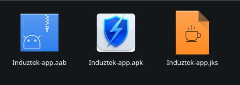

# Induzteck App — Plataforma de Protocolos Eléctricos y Control en Terreno

Aplicación móvil desarrollada en **Android Studio** con **Jetpack Compose** y **Kotlin**, orientada a la gestión operativa de inspecciones eléctricas, registro de protocolos en terreno (transformadores, celdas MT, interruptores, relés de protección, cables de poder), consulta de clientes/instalaciones y control de perfiles con avatares multimedia.

---

##  Integrantes
* **Benjamin Andurandegui**
* **Constanza Arriaza**
* **Asignatura:** Desarrollo de Aplicaciones Móviles
* **Sección:** 011D

---

## Funcionalidades Implementadas

1. **Interfaz Visual con Material 3 & Jetpack Compose:**
   * Diseño adaptativo con soporte para tema claro y oscuro.
   * Jerarquía visual optimizada para operadores en terreno y clientes.

2. **Formularios Validados:**
   * **Registro de usuarios y Login:** Validación de RUT chileno con algoritmo Módulo 11, correo electrónico, contraseña fuerte (mayúscula, minúscula, número, símbolo, mínimo 8 caracteres) y campos comerciales para empresas.
   * **Creación de Protocolos:** Validación en tiempo real de condiciones ambientales en terreno (temperaturas entre -10°C y 60°C, humedad entre 0% y 100%) y selección de pruebas según el tipo de equipo.

3. **Navegación Protegida (Jetpack Navigation Compose):**
   * Flujos seguros entre Login, Registro, Recuperación de Contraseña, Panel Principal, Crear Protocolo, Historial, Detalle de Respaldo Digital, Lista de Clientes, Instalaciones, Borradores y Perfil de Usuario.

4. **Gestión de Estado (MVVM con `StateFlow`):**
   * Arquitectura reactiva unidireccional desacoplada de la interfaz gráfica usando `StateFlow` y `collectAsStateWithLifecycle()`.

5. **Consumo de Microservicios propios (Retrofit):**
   * Integración completa mediante cliente HTTP Retrofit apuntando a la URL configurable `INDUZTEK_API_URL` (soporta IP local `10.0.2.2`, ADB port forwarding o VS Code Dev Tunnels).

6. **Uso de Recursos Nativos del Dispositivo:**
   * **Cámara y Galería:** Selección de imágenes de galería o captura directa con la cámara nativa con compresión automática a JPEG (`ConvertidorImagen`) para avatares de perfil.
   * **Geolocalización GPS:** Detección de ubicación en terreno mediante `LocationManager` y `Geocoder` para autocompletar direcciones en instalaciones.
   * **Permisos en tiempo de ejecución:** Gestión segura de permisos para cámara y ubicación con retroalimentación mediante `Snackbar`.

7. **Recursos Nativos del Dispositivo:**
   * **Cámara y Galería:** Captura de fotos o selección desde galería con compresión automática a JPEG (`ConvertidorImagen`) para foto de perfil.
   * **Geolocalización GPS:** Obtención de coordenadas y autocompletado de dirección mediante `LocationManager` y `Geocoder`.

8. **Pruebas Unitarias:**
   * Cobertura de validaciones y lógica de negocio con JUnit en ViewModels (`LoginViewModelTest`, `CrearProtocoloViewModelTest`, `FormularioValidacionRutTest`, `FormularioValidacionEmpresaTest`, `ListaClientesViewModelTest`, `ListaInstalacionesViewModelTest`).

---

##  Endpoints Utilizados

La aplicación se comunica con los **microservicios en Spring Boot** y servicios externos mediante llamadas HTTP asíncronas con **Retrofit 2** y convertidor **Gson**.

###  1. Microservicio de Autenticación y Usuarios (`/api/auth`, `/api/usuarios`)
* `POST /api/auth/login`: Autenticación de usuario y obtención de Token JWT.
* `POST /api/auth/activar`: Activación inicial de cuenta de usuario.
* `POST /api/auth/recuperar`: Solicitud de código o enlace para restablecer contraseña.
* `POST /api/auth/restablecer`: Restablecimiento de contraseña con nueva clave.
* `POST /api/usuarios`: Registro de nuevos usuarios (Técnicos / Clientes).
* `GET /api/usuarios/me`: Obtención de información del perfil del usuario autenticado.
* `PUT /api/usuarios/me`: Actualización de datos del perfil.
* `PUT /api/usuarios/me/contrasena`: Cambio de contraseña de usuario.
* `POST /api/usuarios/me/avatar`: Carga multipart de imagen de avatar de perfil.

###  2. Microservicio de Activos y Clientes (`/api/activos`)
* `GET /api/activos/regiones`: Listado de regiones para formularios geográficos.
* `GET /api/activos/comunas`: Listado de comunas filtradas por región.
* `GET /api/activos/tipos-equipo`: Catálogo de tipos de equipos eléctricos (Transformadores, Interruptores, Celdas MT, etc.).
* `GET /api/activos/clientes`: Listado de clientes comerciales (con filtro opcional por nombre o RUT).
* `GET /api/activos/clientes/{idCliente}/instalaciones`: Instalaciones asociadas a un cliente específico.
* `GET /api/activos/instalaciones/{idInstalacion}`: Detalle de una instalación eléctrica.
* `GET /api/activos/instalaciones/{idInstalacion}/equipos`: Equipos instalados en un recinto específico.
* `GET /api/activos/equipos/{idEquipo}`: Ficha técnica y datos de un equipo eléctrico.
* `POST /api/activos/instalaciones`: Registro de una nueva instalación eléctrica.
* `POST /api/activos/equipos`: Registro de un nuevo equipo en una instalación.

###  3. Microservicio de Protocolos de Prueba (`/api/protocolos`)
* `GET /api/protocolos/catalogos/tipos-prueba?idTipoEquipo={id}`: Tipos de prueba compatibles según el equipo.
* `GET /api/protocolos/catalogos/tipos-prueba/{id}/parametros`: Parámetros a medir en cada prueba (voltaje, resistencia de aislamiento, corriente de fuga, etc.).
* `POST /api/protocolos/borradores`: Creación de encabezado de protocolo borrador.
* `PUT /api/protocolos/{id}/borrador`: Actualización de cabecera de borrador en edición.
* `POST /api/protocolos/{id}/pruebas/seleccionadas`: Guardar pruebas seleccionadas para el protocolo.
* `POST /api/protocolos/{id}/pruebas`: Guardado de mediciones tomadas en terreno.
* `PUT /api/protocolos/{id}/estado`: Cambio de estado del protocolo (Borrador -> Finalizado / Aprobado).
* `POST /api/protocolos/{id}/preparar-edicion`: Preparación de protocolo para modificación.
* `POST /api/protocolos/{id}/reemplazar`: Reemplazo de protocolo.
* `GET /api/protocolos/borradores/me`: Lista de protocolos borradores del usuario actual.
* `GET /api/protocolos/historial`: Historial general de protocolos finalizados.
* `GET /api/protocolos/equipos/{idEquipo}`: Historia de pruebas realizadas a un equipo.
* `GET /api/protocolos/clientes/me`: Protocolos pertenecientes al cliente autenticado.
* `GET /api/protocolos/{id}`: Detalle completo de un protocolo finalizado o borrador.

---

##  Apk, Firma y Llave



* **`Induztek-app.apk`**: Archivo ejecutable firmado digitalmente listo para instalación en dispositivos.
* **`Induztek-app.aab`**: Android App Bundle generado para publicación.
* **`Induztek-app.jks`**: Almacén de llaves de seguridad de la aplicación.


---

##  Planificación y Control de Versiones (Trello & GitHub)

* **Organización de Tareas (Trello):** Flujo de trabajo distribuido en historias de usuario.
* **Control de Versiones (GitHub):** Registro de commits frecuentes realizados por ambos integrantes (*Benjamin Andurandegui* y *Constanza Arriaza*) tanto en el repositorio móvil como en el microservicio backend.

---

##  Pasos para Ejecutar el Proyecto

1. **Clonar o descargar el repositorio:**

* Abre tu terminal y clona el repositorio del proyecto en tu equipo.
* Encender laragon.
* Ejecutar los microservicios en VSC desde Spring Dashboard : eureka -> usuarios -> activos -> protocolos -> api gateway.
* Despues, en el apartado ports del terminal de VSC, se agrega el puerto 8090, y se modifca su url para que sea publica.

2. **Abrir en Android Studio:**
   * Inicia **Android Studio**.
   * Selecciona *Open* y navega hasta la carpeta `induzteck-app`.
   * Espera a que finalice la sincronización de Gradle (`Sync Project with Gradle Files`).

3. **Configurar la URL de los Microservicios en `gradle.properties`:**
   * **Con VS Code Dev Tunnels:**
     ```properties
     INDUZTEK_API_URL=https://cwsrpx4x-8090.brs.devtunnels.ms/
     ```
   *  O similar
   * **Con Emulador Android (Localhost):**
     ```properties
     INDUZTEK_API_URL=http://10.0.2.2:8090/
     ```

4. **Ejecutar Pruebas Unitarias:**
   * En la terminal de Android Studio o del sistema:
     ```bash
     ./gradlew testDebugUnitTest
     ```

5. **Ejecutar la Aplicación en Emulador o Dispositivo:**
   * Presiona `Shift + F10` o haz clic en **Run 'app'**.

6. **Credenciales de Prueba:**
   * **Técnico / Ingeniero:** `tecnico@induztek.cl` / Contraseña: `Abc1234@`
   * **Cliente:** `cliente@ejemplo.cl` / Contraseña: `Abc1234@`
